<!-- contribution graph: real data, cells pop in one by one.
     regenerated daily by .github/workflows/update-profile-art.yml -->

<h3><code>abdo@github ~ $ ./contributions.sh</code></h3>

 
 

<!-- ascii portrait (left) + whoami/stats card (right). both are 840x880,
     so equal widths give equal heights.
     portrait: built from source-photo.png (or your GitHub avatar if there isn't one)
     card:     edit profile.json to change the whoami lines -->

<h3><code>abdo@github ~ $ whoami</code></h3>

<table>
<tr>
<td valign="top"></td>
<td valign="top"></td>
</tr>
</table>

 
 

<h3><code>abdo@github ~ $ ./links.sh</code></h3>

<b>Software Engineer · Mobile Application Developer · Flutter</b>

