<!-- greeting that types itself out. edit "intro" in profile.json -->

 
 

<!-- contribution graph: real data, cells pop in one by one -->

<h3><code>abdo@github ~ $ ./contributions.sh</code></h3>

 
 

<!-- ascii portrait + whoami/stats card. plain inline images (no table) so they
     sit side by side on desktop and stack on top of each other on phones -->

<h3><code>abdo@github ~ $ whoami</code></h3>

 
 

<!-- tech stack. edit "stack" in profile.json -->

<h3><code>abdo@github ~ $ ./stack.sh</code></h3>

 
 

<h3><code>abdo@github ~ $ ./links.sh</code></h3>

<b>Software Engineer · Mobile Application Developer · Flutter</b>

